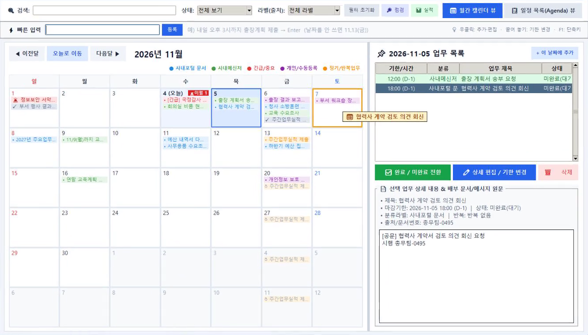

# 사내 업무 캘린더 & 투두 매니저

> 공문·메신저 쪽지에서 **할 일과 마감일을 자동으로 찾아** 캘린더에 올려 주는 Windows 데스크톱 프로그램입니다.
> 인터넷이 없는 업무망에서, **Python 표준 라이브러리만으로** 동작합니다.


<sub>※ 화면의 업무 데이터는 모두 가상입니다.</sub>

## 왜 만들었나

- 맡은 업무를 놓쳐 한 달 반 뒤에야 급히 처리한 일이 있었습니다. 공문과 쪽지로 받은 일을 **기억에만 의존하는 방식 자체가 위험**이었습니다.
- 업무망에서는 구글 캘린더·노션 같은 외부 도구를 쓸 수 없어, **망 안에서 혼자 돌아가는 자동화 도구**가 필요했습니다.

## 한눈에 보기

| | 하는 일 |
|---|---|
| 📥 **자동 수집** | 공문 PDF는 폴더에 저장만, 메신저 쪽지·업무관리시스템 문서는 창을 열기만 하면 업무로 등록 |
| 🧠 **규칙 엔진** | AI 없이 한국어 날짜 표현(`'26.11.4(수)`, `내일 오후 3시까지`, `차주 월요일`)과 요청 문장을 점수로 판단. "알겠습니다" 같은 답장과 통보형 공지는 제외하고, 애매한 건은 '확인 필요'로 사용자에게 넘김 |
| 🔔 **놓치지 않기** | 출근 브리핑 팝업, 마감 알림과 다시 알림, 기한이 지난 미완료 업무는 매일 맨 위로 이월 |
| 🗓 **캘린더** | 월간·목록 보기, 반복 업무 미리보기, 여러 날에 걸친 기간 업무, 끌어다 놓아 기한 변경, 한 줄 빠른 입력, 처리 실적 요약 |

## 기술 포인트

- **외부 패키지 0개**: `tkinter`, `sqlite3`, `ctypes` 등 표준 라이브러리만 사용해, 보안 심사에서 문제가 될 서드파티 모듈이 없습니다.
- **PDF 글자 추출기 직접 구현** ([`parsers/pdf_text.py`](parsers/pdf_text.py)): 압축 해제, 한글 인코딩(UniKS-UCS2, KSCms-UHC), 내장 폰트 글자표 복원까지 처리합니다.
- **다른 프로그램을 건드리지 않는 화면 읽기**: 후킹이나 패킷 감청 없이, 화면 낭독기가 쓰는 Windows 접근성 메시지(`WM_HTML_GETOBJECT`)로 창에 보이는 본문만 읽습니다.
- **오탐 줄이기**: 쪽지의 업무 여부를 단어 일치에서 점수제로 바꿨습니다. 잘못 등록되던 실제 쪽지 20건에서 오등록이 **19건 → 0건**이 됐고(애매한 5건은 '확인 필요'로 분리), 진짜 업무 쪽지는 그대로 등록됩니다 ([`parsers/message_scorer.py`](parsers/message_scorer.py)).
- **공문에도 같은 판정**: 업무관리시스템 문서 본문을 같은 점수표로 판정하고, 알리기만 하는 통보형 표현을 감점합니다. 실제 공문 10건에서 사용자가 직접 나눈 결과(업무 5 · 업무 아님 2 · 애매 3)와 **10건 모두 일치**했습니다. 원문은 저장소에 올리지 않고, 저장소 밖 폴더에서 건수만 출력하는 평가 스크립트로 확인합니다 ([`scripts/gongmun_sample_eval.py`](scripts/gongmun_sample_eval.py)).
- **기간(`~`) 읽기와 반복 기간**: `11/10~14`, `'26.11.3(화) ~ 11.20(금)` 같은 기간을 시작일·마감일로 나눕니다. `3~4명`, `1.5~2배` 같은 숫자 범위와 인용 문서 날짜·인쇄일은 기한으로 읽지 않습니다. 반복 기간 업무는 구글 캘린더의 여러 날 일정처럼 다루어, 완료하거나 기간이 끝나면 다음 기간이 열립니다.
- **자동 테스트 436개**, 앱 코드 약 11,100줄. 실사용 중 찾은 오류는 재현한 뒤 회귀 테스트로 남겼습니다.

## 개발 방식

- Claude Code와 함께 **요구사항 → [작업계획서](작업계획서.md) → 구현 → 실제 샘플로 오류 재현 → 회귀 테스트** 순서로 약 2주 동안 개발했습니다.
- AI는 개발 과정에서만 썼고, **완성된 프로그램은 AI나 외부 서버를 전혀 호출하지 않습니다.**

## 바로 실행

```bash
python main.py
```

Windows + Python 3.12면 추가 설치 없이 실행됩니다. 무설치 실행본 만들기는 [실행 방법](#실행-방법)을 보세요.

| 목차 | |
|---|---|
| [상세 기능](#상세-기능) | 수집 방식, 화면 구성, 단축키 |
| [알려진 한계](#알려진-한계) | 규칙 기반 판단의 한계 |
| [보안 설계](#보안-설계) | 오프라인 동작, 읽기 전용 원칙 |
| [실행 방법](#실행-방법) | 소스 실행, 무설치 실행본 빌드 |

---

## 상세 기능

1. **사내포털 배부 문서 & 메신저 지시사항 자동 스캔**
   - **폴더 자동 감시(`scan_inbox/`)**: 사내포털이나 메신저에서 사용자가 저장한 파일(`.txt`, `.pdf`, `.html`, `.md` 등)을 백그라운드에서 자동 감지하여 제목·문서번호·마감기한을 추출해 캘린더에 자동 등록합니다.
   - **클립보드 즉시 스캔(`Ctrl+Shift+V`)**: 파일로 따로 저장할 필요 없이, 사내포털 화면이나 메신저 내용을 드래그 후 복사(`Ctrl+C`)하고 `[📋 클립보드 스캔]`을 누르면 즉시 파싱·등록됩니다.
2. **출근 시 자동 브리핑 팝업 & 기한 도래 상시 알림**
   - 프로그램 실행 시(또는 출근 부팅 시) 최상단 팝업으로 **[🚨 기한경과 미완료 이월 업무 / 📌 오늘 마감 업무 / ⏳ 내일·7일 이내 마감 / 📥 신규 자동스캔 문서]**를 브리핑합니다. 상단 `[🔔 출근 브리핑]`으로 언제든 다시 열 수 있습니다.
   - **오늘 마감인 업무는 마감 2시간 전부터, 기한이 지난 업무는 하루 한 번** 화면 우측 하단에 알림 팝업이 뜨며, **`완료 처리 / 30분 뒤 / 2시간 뒤 / 내일 아침 다시 알림(Snooze)`**을 고를 수 있습니다.
3. **구글 캘린더 기반 보완 기능 6종 탑재**
   - **① 색상 라벨 구분**: `사내포털 문서(파랑)`, `사내메신저(초록)`, `긴급/중요(빨강)`, `개인/수동등록(보라)`, `정기/반복업무(주황)`
   - **② 미완료 업무 자동 이월(Rollover)**: 기한이 지났는데 완료 체크하지 않은 업무는 **오늘 날짜 칸과 목록 최상단에 붉은색 경고로 계속 이월**되어 절대 누락되지 않습니다.
   - **③ 반복 일정**: 매일/매주/매월 반복 업무는 완료 체크 시 다음 주기 일정이 자동 생성됩니다. 월간 캘린더에는 앞으로의 날짜가 `↻` 표시로 흐리게 미리 보입니다(저장되지 않는 미리보기, 두 번 누르면 반복 업무를 엶). 업무 추가·편집 창에서 반복을 고르면 라벨이 기본값(개인/수동등록)일 때 `정기/반복업무(주황)`로 바뀝니다.
   - **④ 알림 다시 알림(Snooze)**: 30분 뒤 / 2시간 뒤 / 내일 아침 09:00 다시 알림
   - **⑤ 실시간 키워드 검색 & 필터**: 제목·본문·문서번호·발신자 검색, 상태(미완료 전체 / 기한경과 / 신규 자동스캔 / 대기 / 진행중 / 완료)·라벨별 필터링
   - **⑥ 뷰 전환**: 직관적인 `월간 캘린더 뷰(Month View)`와 다가오는 마감순 `일정 목록 뷰(Agenda View)` 지원
   - **⑦ 우클릭 메뉴**: 캘린더 날짜 칸을 우클릭하면 `새 업무 추가`·`빠른 입력으로 추가`, 일정을 우클릭하면 `편집`·`완료 처리(완료된 일정은 미완료로 되돌리기)`·`하루 미루기`·`다음 주 월요일로`·`삭제`. 오른쪽 업무 목록과 일정 목록 뷰에서도 같은 메뉴가 뜹니다.
   - **⑧ 끌어다 놓기로 기한 변경**: 월간 캘린더의 일정을 마우스로 끌어 다른 날짜 칸에 놓으면 마감일이 바뀝니다(마감 시각은 그대로, 이미 보낸 알림은 다시 울리도록 초기화).
   - **⑨ 빠른 입력**: 필터 줄 아래 `⚡ 빠른 입력`에 `내일 오후 3시까지 출장계획 제출`처럼 한 줄로 쓰고 Enter를 누르면, 공문·쪽지와 같은 날짜 규칙으로 기한·시각을 읽어 바로 등록합니다. 입력하는 동안 `→ 11.3(화) 15:00 · 출장계획 제출` 식으로 미리 보여 줍니다. 날짜를 안 쓰면 캘린더에서 선택한 날짜로, `긴급`이 있으면 긴급 라벨, `매주`가 있으면 반복 업무로 등록합니다.
   - **⑩ 처리 실적 요약**: 필터 줄의 `📊 실적`으로 미완료·기한경과·오늘 마감 건수, 이번 주·이번 달 새로 등록(그중 자동 수집)·완료 건수와 기한 내 처리율, 최근 4주 완료 추이를 봅니다.
   - **⑪ 기간 업무**: 업무 추가·편집 창의 `시작일 (기간일 때)`에 날짜를 넣으면 시작일~마감일이 한 업무(기간)가 됩니다(마감일 = 끝 날짜). 월간 캘린더에는 시작~끝 모든 칸에 표시되고(이어지는 칸은 `▸ `), 끌어다 놓으면 기간 전체가 같은 길이로 이동합니다. 날짜를 누르면 그 날이 기간 안에 든 업무도 목록에 나오고, 업무 목록에는 `MM/DD~MM/DD`, 상세에는 `기간: …`으로 보입니다. `반복 + 기간` 업무는 완료하거나 끝나는 날이 지나면 같은 길이의 다음 기간이 활성화되고, 끝난 기간을 완료하지 않았으면 기한경과로 남습니다. 지운 다음 기간은 다시 생기지 않으며, 프로그램을 켤 때와 하루 한 번 확인합니다.
4. **업무관리시스템·메신저 저장 파일 연동** (`scan_inbox/`에 넣으면 자동 처리)

   | 파일 | 처리 방식 |
   |---|---|
   | 공문 `.pdf` (글자 선택 가능한 PDF) | 제목·처리기한(예: `'26.11.4(수)`, `2026. 11. 6.(금)까지`)·시행번호를 찾아 업무로 등록. 같은 공문을 다시 받아도 문서번호 기준으로 중복 없음 |
   | 메신저 저장 `발신자-YYYY-MM-DD_HHMMSS.txt` | 맨 위 받은 메시지(`송신:/시간:/제목:/내용:`)만 업무로 판단하고, `-----` 아래 인용된 이전 대화는 설명에 참고용으로 붙임. `내일까지` 같은 표현은 **받은 시각 기준**으로 계산. "알겠습니다"·"확인했습니다" 같은 답장은 등록하지 않음. 첫 줄의 인사·자기소개("기획팀 OOO입니다.")는 제목에서 건너뜀. "아래 내용 확인 부탁드립니다"처럼 전달만 한 메시지는 인용된 메시지의 기한을 사용. 같은 메시지 재저장 시 중복 없음 |

   - **한 번에 등록하기**
     - **감시 폴더 지정(권장)**: 상단 `[⚙ 감시 폴더 설정]` → `[＋ 폴더 추가]`로 메신저 쪽지 저장 폴더, 공문 PDF 다운로드 폴더를 추가하면 저장하는 즉시(15초 이내) 자동 등록됩니다. 설정은 `config.json`에 저장됩니다.
       - **받을 파일 `쪽지·공문만`**(새 폴더 기본값): 쪽지 이름 형식의 txt와, 시행번호 또는 '제 목'·'수신' 항목이 있는 공문 PDF만 처리합니다. 다운로드 폴더의 다른 파일은 무시합니다.
       - **가져올 범위**(새 폴더 기본값 `오늘부터 저장된 파일`): 폴더에 쌓여 있던 예전 쪽지가 한꺼번에 등록되지 않게 합니다. `최근 7일`·`최근 30일`·`전체 파일`로 바꿀 수 있습니다.
       - 이미 확인한 파일은 수정 시각이 그대로면 다시 읽지 않아, 큰 폴더를 감시해도 PC가 느려지지 않습니다.
     - **여러 파일 불러오기**: `[📄 파일 불러오기]`에서 Ctrl·Shift 클릭 또는 Ctrl+A로 여러 파일을 고르면 한 번에 등록되고, 파일마다 결과(새 업무 등록·기존 업무 갱신·업무 아님·제외)가 목록으로 표시됩니다.
   - 업무관리시스템 문서 목록 `.csv`는 할 일로 쓸 정보가 없어 **기본으로 읽지 않습니다**. 목록 형식이 바뀌어 쓸 만해지면 `config.json`의 `supported_extensions`에 `".csv"`를 넣으면 됩니다(문서번호 기준 중복 방지, 처리상태 완료 반영, 기한 추정 기능은 남아 있음).
   - **파일 점검(등록하지 않음)**: 상단 필터 줄의 `[🔎 점검]` 버튼으로 실제 파일을 고르면, 글자 깨짐·인식한 열·추출 기한·문서번호를 보여줍니다. `[공유용 요약 복사]`는 파일 이름·제목·본문을 뺀 구조 정보만 복사합니다. Python이 있으면 `python -m parsers.import_check <파일 또는 폴더>`로도 실행됩니다.
   - PDF 한글 복원: ToUnicode 정보 → 한글 표준 인코딩(UniKS-UCS2, KSCms-UHC 등) → 내장 폰트의 글자표 순으로 시도합니다. 스캔 이미지 PDF·암호화(보안 설정) PDF·DRM으로 잠긴 파일은 읽을 수 없으며, 점검 결과에 그 이유가 표시됩니다.
   - 공휴일은 `config.json`의 `"holidays": ["2026-12-25"]`에 넣으면 기한 추정에서 제외됩니다.

5. **EzQ 메신저 받은쪽지 자동 수집** (파일 저장 없이)
   - 투두리스트가 켜져 있는 동안 3초마다 열려 있는 EzQ **받은쪽지 창의 본문**을 읽어, 처음 보는 쪽지만 위 메신저 규칙(업무 판단·기한 추출·답장 제외)으로 등록합니다. 상단 `EzQ 쪽지 수집` 체크로 켜고 끕니다(`config.json`의 `ezq_auto_collect`).
   - **받은 시각**은 쪽지 창을 처음 발견한 시각으로 대신합니다(`내일까지` 등의 기준). 쪽지 창의 **보낸 사람·보낸 시각 칸**은 메신저가 화면에 직접 그려 읽을 수 없습니다. 본문 끝에 `발신자 :` 줄이 있으면 그 이름이 출처에 표시됩니다.
   - 쪽지 창이 떠 있어야 읽을 수 있습니다. 창을 열지 않은 쪽지는 수집되지 않습니다.
   - 같은 쪽지는 창을 여러 번 확인하거나 프로그램을 다시 켜도 한 번만 등록됩니다.
   - 메신저 버전이 바뀌어 창 종류 이름이 달라지면 `config.json`의 `ezq_window_class`(기본 `TfrmReceiveMessage`)를 바꿉니다.

6. **업무관리시스템 문서 자동 수집** (v1.4.0, 문서 창을 열기만 하면)
   - 업무관리시스템 문서 창(Edge IE 모드)을 열면, 본문을 그리는 **한컴 웹한글 기안기의 본문 꺼내기 기능**(`GetTextFile('TEXT')`)으로 본문 글자를 받아 공문 PDF와 같은 규칙으로 **제목·문서번호(하단 `시행` 번호)·회신기한**(`'26.11.7(금)` 등)을 뽑아 등록합니다. 상단 `업무관리 문서 수집` 체크로 켜고 끕니다(`config.json`의 `workmgmt_auto_collect`).
   - 본문은 canvas에 그림으로 그려져 화면 글자로는 읽을 수 없어 기안기 기능을 씁니다. 문서를 고치거나 저장하지 않습니다. 기안기가 결과를 늦게 돌려주므로 문서 창을 연 뒤 몇 초(확인 두 번) 뒤에 등록됩니다.
   - 문서 창마다 본문은 한 번만 받습니다. 같은 공문을 PDF·클립보드 스캔으로 받아도 문서번호 기준으로 하나가 되고, 한 번 받은 문서는 업무를 지웠어도 다시 등록하지 않습니다.
   - **쪽지와 겹치는 경우**: 같은 공문을 동료 쪽지로도 받았으면(기한이 같은 날이고 제목 주제어가 겹침, 예: `감사실 내부통제 자가진단 공문 왔습니다. 11/7까지 제출 부탁`) 새로 만들지 않고 먼저 있던 업무의 출처에 덧붙입니다(쪽지가 나중에 와도 같음). 업무관리시스템의 결재·배부 알림 쪽지는 쪽지 수집에서 제외됩니다.
   - **배부받은 문서**: [전자문서 > 결재 > 결재시행] 목록 화면을 열어 두면, 표에서 문서종류 `수신` + 처리구분 `업무담당자`·`업무관리자` 행을 찾아 `❔ 확인 필요`로 둡니다(목록에는 제목뿐이라 업무인지 알 수 없고, 배부 문서의 대부분이 안내·통보 공문이라 바로 등록하면 과탐이 됨). 그 문서를 열면 본문을 쪽지와 같은 점수표로 판정해 등록 / 확인 필요 유지 / 제외로 나누고, 본문의 회신기한으로 기한을 확정합니다(목록 번호가 본문 시행번호와 달라도 배부 기록·제목으로 같은 업무를 찾음). `업무 맞음`으로 직접 확정한 배부 업무는 다시 판정하지 않습니다. 한 번 본 배부 건은 업무를 지웠거나 `업무 아님`으로 정리했으면 다시 만들지 않습니다.
   - **문서 본문 판정**: 문서 본문은 배부 여부와 상관없이 쪽지와 같은 점수표로 판정합니다. 업무로 확실하면 등록, 애매하면 `❔ 확인 필요`, 안내·통보성이면 제외하고 `🧾 제외된 쪽지·문서` 창에 판정 근거와 함께 남깁니다(`업무로 등록`으로 되살릴 수 있음).
   - **`~` 기간 자동 읽기**: `11/10 ~ 11/14`, `11.10.~11.14.`, `11월 10일 ~ 11월 14일`, `11/10~14`, `2026.11.10 ~ 2026.11.20`처럼 쓴 기간은 시작일·마감일로 나눠 기간 업무로 등록합니다(쪽지·업무관리시스템 문서·폴더/클립보드 스캔·빠른 입력 공통, 점수표도 기간을 명시 기한으로 봄). `3~4명`, `~3쪽`, `1.5~2배` 같은 숫자 범위는 기간으로 읽지 않고, 같은 줄에 다른 기한(`~까지`)이 있으면 그 기한을 우선합니다.
   - **통보형 공문 걸러내기**: `안내해드립니다`·`참고하시기 바랍니다`·`숙지하시기 바랍니다`처럼 알리기만 하는 표현은 점수를 깎고, 요청 표현이 없는 문서는 기한과 업무 단어가 같은 줄에 있지 않으면 제외합니다(제외된 문서는 `🧾 제외된 쪽지·문서`에서 되살림). 이 판정은 업무관리시스템 문서 창·쪽지에만 적용되며, 폴더·클립보드로 넣은 PDF/txt는 예전 판정 그대로입니다(기한·기간 읽기만 개선). 공문 폴더의 본문을 업무관리시스템 문서 창이라면 어떻게 판정할지는 `python scripts/gongmun_sample_eval.py <폴더>`로 건수와 번호별 결과만 확인할 수 있습니다(제목·본문은 출력하지 않음).
   - 공문 본문에 인용된 다른 문서번호(`문서번호 감사실-123(…) 「…」 관련하여`)는 이 문서의 번호로 쓰지 않습니다 (예전 공문 업무와 잘못 합쳐지던 문제, 공문 PDF에도 적용).

7. **화면에서 할 수 있는 일**

   | 위치 | 기능 |
   |---|---|
   | 상단 버튼 | `폴더 스캔(F5)` 감시 폴더 즉시 확인 · `파일 불러오기` 여러 파일 한 번에 등록 · `클립보드 스캔(Ctrl+Shift+V)` · `붙여넣기 스캔` 창에 내용을 붙여넣어 등록 · `새 업무 추가(Ctrl+N)` 직접 입력 · `출근 브리핑` |
   | 상단 체크 | `출근 시 자동실행`(Windows 시작 시 실행, 관리자 권한 불필요) · `EzQ 쪽지 수집` · `업무관리 문서 수집` 켜기/끄기 |
   | 상단 왼쪽 | 최근 자동 등록 결과 표시 · `감시 폴더 설정` |
   | 필터 줄 | 검색 · 상태/라벨 필터 · `필터 초기화` · `🔎 점검`(등록하지 않고 인식 결과만 보기) · `📊 실적`(처리 실적 요약) · 월간 캘린더 / 일정 목록 뷰 전환 |
   | 빠른 입력 줄 | 한 줄로 쓰고 Enter → 기한·시각을 읽어 바로 등록 (입력 중 미리보기, 등록·기한 변경 결과 표시) |
   | 월간 캘린더 | 칸 클릭: 날짜 선택 · 칸 더블클릭: 그 날짜에 새 업무 · 일정 더블클릭: 편집 · **우클릭: 메뉴** · **일정 끌어다 놓기: 기한 변경** |
   | 오른쪽 패널 | 선택한 날짜의 업무 목록(우클릭 메뉴), `완료 / 미완료 전환`, `상세 편집 / 기한 변경`, `삭제`(Ctrl·Shift 클릭으로 여러 건을 골라 한 번에), 선택 업무의 상세 내용과 원문 |

8. **키보드 단축키** (`F1`을 누르면 화면에서도 볼 수 있습니다)

   | 쓰는 곳 | 키 |
   |---|---|
   | 어디서나 | `Ctrl+N` 새 업무 · `Ctrl+L` 빠른 입력 칸으로 · `Ctrl+1` 오른쪽 날짜 업무 목록으로 · `Ctrl+2` 일정 목록 보기로 · `Alt+←/→` 이전/다음 달 · `Ctrl+T` 오늘 · `F5` 폴더 스캔 · `Ctrl+Shift+V` 클립보드 스캔 · `F1` 단축키 안내 |
   | 업무 목록 (오른쪽 목록·일정 목록) | `↑/↓` 이동 · `Shift+↑/↓`, `Ctrl+A`, Ctrl·Shift 클릭: 여러 건 선택 · `Esc` 선택 해제 · `Enter` 편집 · `Space` 완료/미완료 전환 · `Delete` 고른 업무 모두 삭제(확인 창에 건수 표시) |
   | 업무 편집 창 | `Ctrl+Enter` 저장 · `Esc` 닫기(저장 안 함) |

   - `Delete`·`Enter`·`Space`는 업무 목록에 커서가 있을 때만 동작합니다. 빠른 입력 칸에서 `Delete`를 눌러도 업무는 지워지지 않습니다.
   - 달력 칸 위 일정과 우클릭 메뉴의 삭제는 1건씩 지웁니다. 삭제한 업무는 되돌릴 수 없습니다.

---

## 알려진 한계

- 업무인지는 AI 없이 **단어·문장 패턴 규칙**으로 판단합니다. 쪽지와 업무관리시스템 문서는 애매하면 `❔ 확인 필요`로 두고, 폴더·클립보드로 넣은 파일은 놓치는 것보다 잘못 들어오는 쪽이 낫다는 기준으로 등록합니다.
  - 기한이 있는 안내성 공문이나 폴더로 넣은 알림성 파일은 업무로 등록될 수 있습니다. 필요 없으면 삭제하세요.
  - 돌려 말한 지시(요청 표현이나 날짜가 없는 문장)는 등록되지 않을 수 있습니다.
- 여러 명에게 보낸 쪽지에서 내 몫인지는 구분하지 않습니다.
- 기한 변경·취소 쪽지는 기존 업무에 반영되지 않고 새 업무로 등록될 수 있습니다.
- 미완료 반복 기간 업무는 주마다 기한경과 1건씩 쌓일 수 있고, 매일 반복하는 여러 날 기간은 미리보기가 겹쳐 보입니다. 말일로 끝나는 기간은 2월에 하루로 줄어들 수 있습니다.
- `3 명이`처럼 숫자와 단위를 띄어 쓴 범위 일부는 기간으로 읽힐 수 있고, 같은 줄에 `까지`·`마감`이 있으면 끝 날짜만 쓴 기간은 읽지 않습니다.
- EzQ 쪽지와 업무관리시스템 문서는 창을 열어야 수집됩니다. 기한이 없는 업무는 3영업일 뒤로 추정해 `·기한추정`으로 표시합니다.
- 배부 문서는 결재시행 목록 화면을 열어 둔 동안, 목록에 보이는 행만 등록합니다. 결재 처리로 목록에서 사라져도 업무를 자동 완료하지 않습니다.
- 업무관리시스템의 배부·접수·협조 알림 쪽지는 실제 문구를 아직 확인하지 못했습니다. 결재알림과 문구가 다르면 쪽지 업무로 등록될 수 있습니다.
- 스캔 이미지 PDF, 암호화(보안 설정) PDF, DRM으로 잠긴 파일은 읽을 수 없습니다.


---

## 보안 설계

공공기관 보안 환경에서 반입 검토를 받을 수 있도록 다음 원칙을 지켰습니다.


- **외부 네트워크 통신 0%**: 인터넷이나 외부 API(클라우드 LLM 등)를 일체 호출하지 않는 100% 오프라인 프로그램입니다.
- **표준 내장 라이브러리 전용**: Python 공식 표준 라이브러리(`tkinter`, `sqlite3`, `re`, `datetime`, `hashlib`, `json`, `ctypes`, `zlib`, `threading`, `difflib`, `html`, `csv`, `struct`, `winreg` 등)만으로 (PDF 읽기 포함) 구동되어 외부 미검증 서드파티 모듈로 인한 보안 취약점이 없습니다.
- **비침투적 동작**: 타 프로세스 메모리 후킹이나 패킷 감청을 하지 않습니다. 사용자가 저장한 파일·클립보드 텍스트와, EzQ 받은쪽지 창에 화면으로 표시된 본문(화면 낭독기가 쓰는 Windows 접근성 표준 메시지 `WM_HTML_GETOBJECT`로 읽기만 함)만 대상으로 동작하며, 메신저 프로그램·파일은 고치지 않습니다.
- **업무관리시스템 문서 수집 (v1.4.0)**: 같은 방식으로 받은 문서 창 화면에서 **짧은 식을 실행해** 웹한글 기안기의 본문 꺼내기 기능(`GetTextFile('TEXT')`)을 부릅니다. 결과를 받을 변수(`window.__todoTxt`, `__todoReq`)만 그 화면에 두고, 문서 내용·결재·저장에는 손대지 않으며 서버로 아무것도 보내지 않습니다. 문서 창마다 한 번만 부르고, 상단 체크(`workmgmt_auto_collect`)로 끌 수 있습니다. 화면 읽기만 하던 쪽지 수집보다 한 단계 더 들어가는 동작이므로 반입 검토 때 함께 설명합니다.
- **업무관리시스템 배부 문서 (v1.4.0)**: 결재시행 목록 화면에서 표의 글자만 읽는 짧은 식을 실행합니다(읽기 전용, 변수도 만들지 않음). 문서를 열거나 결재·클릭하지 않고 서버에 요청하지 않습니다.

---

## 실행 방법

### 방법 A: Python이 설치된 PC에서 바로 실행
- 요구사항: Python 3.12 (tkinter 포함, python.org 설치본 기본 포함). 추가 패키지 없음.
- `run.bat`(또는 `실행하기.bat`) 더블클릭 또는 터미널에서 아래 명령어 실행:
  ```bash
  python main.py
  ```
- `run.bat`은 Python 3.12 기본 설치 경로 → `pyw` 런처 → PATH의 `python` 순으로 찾으며, Microsoft Store 별칭(가짜 python.exe)은 건너뜁니다.

### 방법 B: 무설치 실행폴더(Portable) 빌드 (보안부서 승인 반입용)
- **인터넷 연결된 PC**에서 `scripts\build_portable.bat` 실행 시 `dist\TodoCalendar_Portable\` 폴더가 생성됩니다. (PyInstaller 설치에 인터넷 필요)
- 해당 폴더를 사내 PC로 반입한 뒤 설치 과정 없이 `TodoCalendar_Portable.exe`를 실행하면 됩니다.
- `config.json`, `todo_data.db`, `scan_inbox\`는 모두 **exe와 같은 폴더**에 위치합니다. 배포본에는 샘플 문서와 개발용 DB가 포함되지 않습니다(빈 `scan_inbox`). 저장소에서도 `scan_inbox` 안의 파일은 git에 올라가지 않습니다.
- 배포본의 `config.json`은 감시 폴더가 기본값(`./scan_inbox`)으로 초기화되어, 빌드한 PC에서 추가한 폴더 경로가 따라가지 않습니다. 사용자용 안내 `사용안내.txt`(원본: `docs/portable_guide.txt`)가 함께 들어갑니다.
- 빌드 결과의 비트수(32/64)는 빌드에 사용한 Python을 따릅니다. 32비트(x86) PC용은 32비트 Python을 지정해 빌드합니다:
  ```bat
  set BUILD_PYTHON=%LOCALAPPDATA%\Programs\Python\Python312-32\python.exe
  scripts\build_portable.bat
  ```
- 서명되지 않은 PyInstaller exe 및 시작프로그램 등록(HKCU Run)은 V3 등 백신에서 오탐될 수 있으므로, 반입 시 보안부서 예외(화이트리스트) 등록을 함께 요청하세요.
